# RoadSentinel AI 🛣️🤖
### AI-Powered Road Health Intelligence, Spatial Telemetry & Closed-Loop Repair Verification Platform

[](https://www.python.org/)
[](https://fastapi.tiangolo.com/)
[](https://pytorch.org/)
[](https://postgis.net/)
[](https://opencv.org/)
[](LICENSE)

---

## 📌 Executive Summary

Traditional road maintenance systems suffer from a critical operational breakdown: **detection is disconnected from remediation and verification**. Standard computer vision projects merely draw bounding boxes around potholes in static images, creating noise without accountability.

**RoadSentinel AI** is an enterprise-grade municipal infrastructure intelligence platform that automates the complete lifecycle:
1. **Perception:** Detects and tracks pavement distress from vehicular dashcam video while deduplicating repeating frames.
2. **Quantification:** Computes volumetric displacement ($m^3$) and estimated asphalt repair tonnage ($kg$).
3. **Dispatch:** Matches GPS coordinates to registered contractor maintenance zones with dynamic SLA timers.
4. **Anti-Fraud Remediation:** Collects contractor repair evidence secured by EXIF geofencing and perceptual hashing.
5. **AI Verification:** Warps perspective using planar homography and executes dual-head validation to confirm defect resolution.
6. **Civic Transparency:** Publishes verified before-and-after audit logs to a public GIS heatmap and computes the municipal Road Health Index (RHI).

---

## 🏛️ System Architecture

```mermaid
flowchart TD
    subgraph L1["1. Ingestion & Telemetry Layer"]
        A1[Dashcam / Mobile Video Stream] --> B1[OpenCV Video Frame Sampler]
        A2[GPX / NMEA / Device GPS Track] --> B2[Temporal Telemetry Synchronizer]
    end

    subgraph L2["2. Computer Vision Perception Layer"]
        B1 --> C1[YOLOv8 Multi-Distress Detection Engine]
        C1 --> C2[ByteTrack Multi-Object Tracker]
        C2 --> C3[Laplacian Blur / Sharpness Filter]
        C3 --> C4[Single Best-Frame Deduplicator]
        C4 --> C5[Monocular Depth & Volume Solver]
    end

    subgraph L3["3. Geospatial & Governance Layer"]
        B2 & C5 --> D1[PostGIS Spatial Query Engine]
        D1 --> D2["Boundary Matcher (ST_DWithin / ST_Contains)"]
        D2 --> D3[Contractor Assignment & SLA Engine]
        D3 --> D4[Incident Repository & Lifecycle State Machine]
        D4 --> D5[Automated Notification Service (SMTP / Webhooks)]
    end

    subgraph L4["4. Contractor Remediation Layer"]
        D5 --> E1[Contractor Web Portal]
        E1 --> E2[Repair Evidence: Before/After Photos + Notes]
        E2 --> E3[Anti-Fraud Guard: EXIF Geofence + pHash Hashing]
    end

    subgraph L5["5. AI Verification Engine (The Core IP)"]
        E3 --> F1[ORB/SIFT Keypoint Extractor]
        F1 --> F2[RANSAC Homography Perspective Warper]
        F2 --> F3[Dual-Head Verification Pass]
        F3 --> F4a[Head A: Residual Distress YOLO Pass]
        F3 --> F4b[Head B: Fresh Bitumen Texture Segmentation]
        F4a & F4b --> F5{Three-State Decision Engine}
    end

    subgraph L6["6. Public & Executive Intelligence Layer"]
        F5 -- REPAIR_SUCCESSFUL --> G1[Status: VERIFIED & Contractor Scorecard +1]
        F5 -- REPAIR_INCOMPLETE --> G2[Status: REWORK_REQUIRED & Penalty Logged]
        F5 -- UNCERTAIN --> G3[Human-in-the-Loop Admin Audit Queue]
        G1 --> H1[Citizen GIS Heatmap & Road Health Index Portal]
    end
```

---

## 🗄️ Database Architecture & Entity Relationships

```mermaid
erDiagram
    ROAD_SEGMENTS ||--o{ INCIDENTS : contains
    CONTRACTORS ||--o{ ROAD_SEGMENTS : maintains
    CONTRACTORS ||--o{ INCIDENTS : assigned_to
    INCIDENTS ||--o| REPAIR_SUBMISSIONS : receives
    REPAIR_SUBMISSIONS ||--|| VERIFICATION_REPORTS : evaluated_by

    ROAD_SEGMENTS {
        string segment_id PK
        string name
        string contractor_id FK
        geometry boundary_polygon
        float total_length_km
    }

    CONTRACTORS {
        string contractor_id PK
        string name
        string company
        string email
        string phone
        float performance_score
        int completed_repairs
    }

    INCIDENTS {
        string incident_id PK
        timestamp created_at
        float latitude
        float longitude
        string road_segment_id FK
        string defect_type
        string severity
        string status
        string contractor_id FK
        timestamp sla_deadline
        string evidence_image_url
        float estimated_volume_m3
        float estimated_asphalt_kg
        float pci_impact
    }

    REPAIR_SUBMISSIONS {
        string submission_id PK
        string incident_id FK
        string contractor_id FK
        timestamp submitted_at
        float submission_lat
        float submission_lng
        string after_image_url
        string engineering_notes
    }

    VERIFICATION_REPORTS {
        string report_id PK
        string incident_id FK
        string outcome
        float confidence_score
        boolean homography_aligned
        int feature_matches_count
        boolean geofence_verified
        float geofence_distance_m
        boolean duplicate_suspected
        boolean residual_defect_found
        float patch_texture_score
        string visual_diff_url
        string explanation
    }
```



---

## 📂 Target Project Directory Structure

```text
AI-Based-Road-Health-Intelligence-Predictive-Maintenance-System/
├── backend/
│   ├── app/
│   │   ├── api/                     # REST API Routers
│   │   │   ├── __init__.py
│   │   │   ├── routes_detect.py     # Video upload, frame inference & tracking
│   │   │   ├── routes_incidents.py  # Incident queries, lifecycle state management
│   │   │   ├── routes_contractors.py# Contractor task queue & repair submission
│   │   │   └── routes_public.py     # Public portal feed & Road Health Index (RHI)
│   │   ├── core/                    # Core System Infrastructure
│   │   │   ├── __init__.py
│   │   │   ├── config.py            # Global thresholds, paths, SLA constants
│   │   │   ├── database.py          # SQLAlchemy ORM / Spatial Database sessions
│   │   │   └── security.py          # Authentication, JWT tokens, RBAC roles
│   │   ├── models/                  # Data Definitions
│   │   │   ├── __init__.py
│   │   │   ├── models_db.py         # SQLAlchemy & PostGIS spatial tables
│   │   │   └── schemas.py           # Pydantic request/response schemas
│   │   ├── services/                # Specialized Domain Engines
│   │   │   ├── __init__.py
│   │   │   ├── detector.py          # YOLOv8 inference, CV fallback, volumetric math
│   │   │   ├── tracker.py           # ByteTrack MOT Kalman tracking & deduplication
│   │   │   ├── spatial.py           # PostGIS boundary matcher & dynamic SLA calculator
│   │   │   ├── verification.py      # ORB homography, pHash anti-fraud, texture analysis
│   │   │   └── notification.py      # Automated email & webhook dispatchers
│   │   └── main.py                  # FastAPI Application Entry & Static Mounts
│   ├── static/                      # Web Client & GIS Operations Portal
│   │   ├── index.html               # Responsive Dark-Mode Operations Dashboard
│   │   ├── css/
│   │   └── js/
│   ├── storage/                     # Local Storage Mounts
│   │   ├── uploads/                 # Raw ingested video streams
│   │   ├── evidence/                # Best-frame cropped defect captures
│   │   └── repairs/                 # Submitted repair photos & homography diffs
│   ├── tests/                       # Automated Test Suites
│   │   ├── test_detection.py        # Computer vision & tracking tests
│   │   ├── test_spatial.py          # Spatial indexing & SLA calculation tests
│   │   ├── test_verification.py     # Homography & anti-fraud tests
│   │   └── test_api.py              # End-to-end integration tests
│   ├── Dockerfile                   # Containerization definition
│   ├── requirements.txt             # Python production dependencies
│   └── run.py                       # Local startup script
├── docs/                            # Architecture diagrams & design notes
├── .gitignore
└── README.md
```

---

## 🚀 Phase-by-Phase Implementation Roadmap

The implementation is structured into **6 sequential phases**. Each phase produces a fully testable deliverable that connects directly into the next stage:

```
┌────────────────────────────────────────────────────────┐
│ Phase 1: Video Ingestion & AI Perception Engine (CV)   │
├────────────────────────────────────────────────────────┤
│ Phase 2: Geospatial Matching & Incident State Machine  │
├────────────────────────────────────────────────────────┤
│ Phase 3: Automated Contractor Notification & Dispatch  │
├────────────────────────────────────────────────────────┤
│ Phase 4: Contractor Dashboard & Evidence Submission    │
├────────────────────────────────────────────────────────┤
│ Phase 5: Closed-Loop AI Verification & Anti-Fraud      │
├────────────────────────────────────────────────────────┤
│ Phase 6: Public GIS Portal & Road Health Index (RHI)   │
└────────────────────────────────────────────────────────┘
```

---

### Phase 1: Video Ingestion & AI Perception Engine (Core CV)
* **Objective:** Ingest moving vehicular video footage, classify pavement distress, deduplicate multiple frames, and estimate repair asphalt volume.
* **Core Tasks:**
  1. Build an OpenCV frame extraction pipeline with configurable frame decimation (e.g., sample every 5 frames).
  2. Integrate fine-tuned **YOLOv8** weights to classify distress according to **ASTM D6433 (PCI)**: Potholes, Alligator Cracks, Longitudinal Cracks.
  3. Implement **ByteTrack Kalman-filter tracking** (`tracker.py`) to associate bounding boxes across consecutive frames under persistent `track_id`s, preventing duplicate tickets.
  4. Implement **Laplacian Variance Focus Filter** ($\text{Var}(\nabla^2 I)$) to isolate the single sharpest, least-blurry frame.
  5. Formulate physical volumetric solver:
     $$\text{Area} = w \times h \times \text{GSD}^2, \quad \text{Volume} = \text{Area} \times \text{Depth}, \quad \text{Mass} = \text{Volume} \times 2400\,\text{kg/m}^3$$
* **Inputs & Outputs:**
  * *Input:* Raw video file (`.mp4`, `.avi`) or RTSP dashcam stream.
  * *Output:* List of deduplicated `TrackedDefect` objects with bounding box coordinates, confidence scores, best-frame image crops, and required asphalt mass in kg.
* **Verification Milestone:**
  * Run a test video through the pipeline; verify that a pothole appearing in 40 consecutive frames generates exactly **1** incident record with optimal image sharpness.

---

### Phase 2: Geospatial Matching & Incident State Machine
* **Objective:** Map defect coordinates against municipal maintenance zones, assign responsible contractors, and establish the incident lifecycle.
* **Core Tasks:**
  1. Parse synchronized spatial telemetry from video files (GPX sidecar, NMEA subtitle streams, or device geolocation).
  2. Implement PostGIS spatial boundary matching using spatial predicates (`ST_Contains`, `ST_DWithin`) against registered road polygons.
  3. Formulate the **Dynamic SLA Engine**:
     * **High Severity:** 24-hour resolution deadline.
     * **Medium Severity:** 72-hour resolution deadline.
     * **Low Severity:** 7-day resolution deadline.
  4. Establish the incident lifecycle state machine:
     $$\text{REPORTED} \longrightarrow \text{ASSIGNED} \longrightarrow \text{IN\_PROGRESS} \longrightarrow \text{VERIFICATION\_PENDING} \longrightarrow \text{VERIFIED} \text{ or } \text{REWORK\_REQUIRED}$$
* **Inputs & Outputs:**
  * *Input:* Defect coordinates `(latitude, longitude)` and severity rating.
  * *Output:* Persisted `Incident` ticket with contract ID, assigned contractor contact, and explicit SLA timestamp.
* **Verification Milestone:**
  * Feed coordinates inside registered Zone 1; verify the ticket is automatically assigned to *Apex Paving Solutions* with a calculated 24-hour SLA deadline.

---

### Phase 3: Automated Contractor Notification & Dispatch
* **Objective:** Alert responsible contractors immediately upon incident creation while eliminating notification spam.
* **Core Tasks:**
  1. Build asynchronous message dispatch using background workers (Celery + Redis or FastAPI background tasks).
  2. Design professional HTML dispatch templates containing incident ID, road segment, GPS coordinates, defect crop preview, and required asphalt tonnage.
  3. Implement **Notification Suppression Logic**: Suppress alerts for identical coordinates reported within a 48-hour cooling period.
* **Inputs & Outputs:**
  * *Input:* Newly created `Incident` record.
  * *Output:* Dispatched email/webhook payload logged with delivery confirmation timestamp.
* **Verification Milestone:**
  * Trigger an incident creation event; verify an email is formatted, sent via SMTP, and recorded in the audit log without blocking API request threads.

---

### Phase 4: Contractor Dashboard & Evidence Submission
* **Objective:** Provide contractors an authenticated web interface to manage assigned tasks and submit completed repair evidence.
* **Core Tasks:**
  1. Develop contractor dashboard views in the frontend portal displaying active tickets, urgency tags, and SLA countdowns.
  2. Build the repair submission endpoint (`POST /api/v1/contractors/submit-repair`).
  3. Capture contractor submission metadata: "after" repair photograph, engineering notes, and device GPS telemetry at submission time.
* **Inputs & Outputs:**
  * *Input:* Authenticated contractor ID, incident ID, "after" image file, and submission coordinates.
  * *Output:* Saved repair submission record; updates incident state to `VERIFICATION_PENDING`.
* **Verification Milestone:**
  * Contractor submits an "after" photo through the web portal; verify the file is stored in `storage/repairs/` and immediately handed off to the verification queue.

---

### Phase 5: Closed-Loop AI Verification Engine & Anti-Fraud *(Core IP)*
* **Objective:** Automatically evaluate repair quality, normalize perspective differences, and block fraudulent submissions.
* **Core Tasks:**
  1. **Anti-Fraud Geofencing:** Compute Haversine distance between defect GPS and submission GPS; fail submissions where $\Delta d > 50\text{m}$.
  2. **Anti-Fraud Perceptual Hashing (pHash):** Compute 64-bit image hashes; reject submissions with Hamming distance $\le 6$ against the "before" image (prevents re-uploading the original defect or stock photos).
  3. **Planar Homography Perspective Warping:**
     * Extract ORB/SIFT keypoint descriptors from both before and after images.
     * Compute homography matrix $H$ using RANSAC feature matching.
     * Warp the "after" photo into the exact planar viewpoint of the original defect image.
  4. **Dual-Head Verification Pass:**
     * *Head A:* Run YOLOv8 on the warped patch zone to verify **zero residual defect**.
     * *Head B:* Analyze bitumen texture uniformity and edge compaction seams.
  5. **Three-State Decision Engine:**
     * `REPAIR_SUCCESSFUL`: Geofence valid, clean pHash, 0 residual defect, patch confirmed $\ge 65\%$.
     * `REPAIR_INCOMPLETE`: Residual pothole detected $\rightarrow$ triggers `REWORK_REQUIRED` and contractor penalty.
     * `VERIFICATION_UNCERTAIN`: Low keypoint alignment ($< 10$ matches) $\rightarrow$ routed to human engineer audit queue.
* **Inputs & Outputs:**
  * *Input:* `before_image_path`, `after_image_path`, and GPS metadata.
  * *Output:* Detailed `VerificationReport` with decision outcome, confidence score, feature match count, explanation, and visual diff image.
* **Verification Milestone:**
  * Run automated verification on a sealed patch; verify homography aligns $\ge 500$ keypoints, flags zero defects, and outputs `REPAIR_SUCCESSFUL`.

---

### Phase 6: Public Transparency Portal & Civic Intelligence
* **Objective:** Deliver citizen-facing transparency and municipal executive dashboards.
* **Core Tasks:**
  1. Build an interactive dark-mode GIS portal using Leaflet.js / Mapbox GL.
  2. Compute the municipal **Road Health Index (RHI / PCI)** on a 0–100 scale:
     $$\text{RHI} = 100 - \sum (\text{Defect Weight}_i \times \text{Severity Multiplier}_i)$$
  3. Implement **Public Audit Cards**: Allow citizens to click any resolved road pin to view side-by-side, AI-verified Before vs After proof.
  4. Provide a public GeoJSON hazard endpoint (`/api/v1/public/hazards`) for potential integration with navigation apps.
* **Inputs & Outputs:**
  * *Input:* Database incident and verification tables.
  * *Output:* Live interactive map, city-wide RHI health gauge, and public audit feed.
* **Verification Milestone:**
  * Open web portal; verify city map pins render dynamically, reflect live RHI updates, and display before/after modal comparisons.

---

## 📡 Complete REST API Specification

| Method | Route | Description | Access Level |
| :--- | :--- | :--- | :--- |
| `POST` | `/api/v1/detect/video` | Ingest video, run YOLO + ByteTrack, create incidents | Patrol / System |
| `POST` | `/api/v1/detect/image` | Run single-frame distress detection and volume math | Internal / Citizen |
| `GET` | `/api/v1/incidents` | List incidents with filtering (status, severity, road) | Public / Contractor |
| `GET` | `/api/v1/incidents/{id}` | Retrieve complete incident audit trail and evidence | Public / Contractor |
| `GET` | `/api/v1/contractors` | Retrieve contractor registry and performance scorecards | Municipal Admin |
| `GET` | `/api/v1/contractors/{id}/assigned` | Retrieve incident queue for a specific contractor | Contractor |
| `POST` | `/api/v1/contractors/submit-repair` | Submit repair photo; triggers AI verification | Contractor |
| `POST` | `/api/v1/verify/evaluate` | On-demand verification execution between two images | Admin / Testing |
| `GET` | `/api/v1/public/rhi` | Retrieve municipal Road Health Index (PCI) score | Public |
| `GET` | `/api/v1/public/portal` | Public road status feed | Public |

---

## 🛠️ Technology Stack Breakdown

| Layer | Technology | Version | Purpose |
| :--- | :--- | :--- | :--- |
| **Deep Learning** | PyTorch / Torchvision | 2.x | Model training and tensor inference execution |
| **Object Detection** | Ultralytics YOLOv8 / v11 | 8.x | Real-time multi-class road distress localization |
| **Object Tracking** | ByteTrack / SORT | - | Multi-object tracking and video frame deduplication |
| **Computer Vision** | OpenCV | 4.x / 5.x | Homography, ORB keypoints, Laplacian sharpness |
| **Anti-Fraud** | ImageHash | 4.x | Perceptual hashing (pHash) duplicate detection |
| **Backend API** | FastAPI | 0.110+ | Asynchronous REST API microservices |
| **Server Engine** | Uvicorn | 0.28+ | High-throughput ASGI server |
| **Spatial Database** | PostgreSQL + PostGIS | 15+ | Geospatial indexing (`ST_Contains`, `ST_DWithin`) |
| **Data Validation**| Pydantic v2 | 2.6+ | Strict data serialization and schema contracts |
| **Frontend UI** | HTML5 / Tailwind CSS | 3.x | Responsive operations dashboard & GIS portal |
| **Mapping Engine** | Leaflet.js / CartoDB | 1.9+ | Interactive GIS map tile rendering |

---

## 💼 Resume-Ready Highlights

### For Machine Learning & Computer Vision Roles:
* *Architected an automated road distress detection and verification system using PyTorch and YOLOv8, classifying pavement defects in compliance with **ASTM D6433 (PCI)** standards.*
* *Engineered a **ByteTrack multi-object tracking (MOT)** pipeline with Kalman filtering, eliminating repeating frame detections and isolating optimal focus frames via Laplacian variance.*
* *Developed an automated **closed-loop verification engine** utilizing **ORB feature matching and RANSAC homography** to warp repair photographs into original camera perspectives, running dual-head residual defect checks and fresh bitumen texture segmentation.*

### For Full-Stack & Backend Systems Roles:
* *Designed a high-throughput asynchronous backend in **FastAPI** orchestrating video ingestion, automated contractor assignment, and AI verification workflows.*
* *Implemented spatial querying with **PostGIS (`ST_Contains`, R-Tree spatial indexing)** to map coordinate telemetry to municipal maintenance contract polygons with dynamic SLA tracking.*
* *Integrated anti-fraud telemetry safeguards using **perceptual hashing (pHash)** and spatial geofencing ($\le 50\text{m}$) to reject recycled or out-of-bounds contractor repair evidence.*

---

## 📄 License
This project is licensed under the MIT License - see the `LICENSE` file for details.
